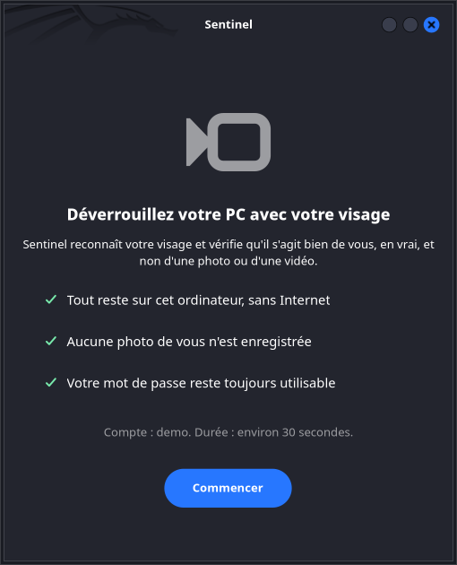

# Sentinel

**Authentification faciale pour Linux, 100 % locale, résistante à l'usurpation sur une webcam ordinaire.**

Les outils existants (Howdy, Gaze…) se laissent tromper par une photo dès qu'il n'y a
pas de caméra infrarouge, enregistrent parfois des images de l'utilisateur, et
stockent des gabarits qu'un attaquant peut remplacer. Sentinel part de ces faiblesses
documentées : voir [`docs/CONCEPTION.md`](docs/CONCEPTION.md).

> ⚠️ **Projet en développement.** Moteur, service et assistant graphique sont prêts ; le
> branchement sur `sudo` et l'écran de verrouillage est l'étape suivante. Le mot de passe
> restera toujours disponible.

| Accueil | Enregistrement guidé | Choix et confirmation |
|---|---|---|
|  |  |  |

## Ce qui le distingue

- **Détection du vivant** : un modèle d'IA distingue la peau d'une photo ou d'un écran,
  décidée sur une moyenne glissante calibrée sur du matériel réel.
- **Enregistrement guidé en 5 poses** (face, gauche, droite, haut, bas) qui mesure le
  **relief 3D** du visage : une photo, plate, ne peut pas être enregistrée.
- **Calibration automatique** du seuil pour chaque personne et chaque webcam, toujours
  bornée par un plancher de sécurité.
- **Aucune image stockée.** Uniquement des empreintes numériques chiffrées en AES-256-GCM,
  liées au compte : un gabarit déplacé, modifié ou fabriqué ailleurs est refusé.
- **Caméra vérifiée** : caméras virtuelles refusées, identité de la webcam épinglée.
- **Modèles d'IA vérifiés** par SHA-256 avant chargement.
- **Clé de chiffrement scellée dans la puce TPM 2.0** (coffre `systemd-creds`) : une copie
  du disque ne permet pas de la déchiffrer sur une autre machine. Validé sur matériel réel.
  Choisie automatiquement à l'installation : TPM 2.0 si disponible, sinon secret du système
  (systemd ≥ 250), sinon fichier root (Ubuntu 22.04).
- **Licences compatibles avec un usage commercial** (MIT, Apache-2.0).

## Installation (Debian, Ubuntu, Kali)

**Le plus simple :** téléchargez **le** paquet `sentinel_<version>-1_amd64.deb` dans les
[Releases](https://github.com/Tiburce-kay/sentinel/releases) — un seul paquet pour toute la
famille Debian — puis double-cliquez dessus, ou :

```bash
sudo apt install ./sentinel_0.2.2-1_amd64.deb
```

**Configuration requise :** PC 64 bits (amd64), webcam, systemd comme système de
démarrage, et une distribution de la famille Debian **au moins aussi récente qu'Ubuntu
22.04 ou Debian 12**. Sur un système plus ancien ou un processeur ARM, `apt` refuse
l'installation. Le paquet embarque son propre Python et ses bibliothèques d'IA : il ne
dépend pas de la version de Python de la distribution.

Ce qui fonctionne dépend du bureau :

| Système | `sudo` | Écran de verrouillage et connexion | Champ du mot de passe masqué, bouton clé | Clé dans la puce TPM |
|---|---|---|---|---|
| Ubuntu 24.04+, Debian 13, Kali — GNOME 45 et plus | ✅ | ✅ | ✅ | ✅ si TPM 2.0 |
| Ubuntu 22.04, Debian 12, Zorin 17 — GNOME 42 à 44 | ✅ | ✅ | ❌ champ visible pendant la vérification | Debian 12 ✅ ; Ubuntu 22.04 ❌ (systemd 249 : clé dans un fichier réservé à root) |
| Linux Mint, Xfce, KDE, COSMIC — autre écran de connexion que GDM | ✅ | ❌ (options grisées dans l'assistant) | — | selon la base |

Dans tous les cas, le mot de passe reste utilisable : webcam absente ou en panne, pièce
sombre, visage non reconnu, service arrêté.

Lancez ensuite **Sentinel** depuis le menu des applications : l'assistant enregistre votre
visage, puis active la reconnaissance pour `sudo` et l'écran de connexion (mot de passe
administrateur demandé). Retirer : `sudo apt remove sentinel` (données conservées) ou
`sudo apt purge sentinel` (données et clé effacées).

**Depuis les sources** (développement) :

```bash
git clone <url-du-depot> sentinel && cd sentinel
sudo scripts/install.sh            # service isolé, module PAM, assistant graphique
```

1. Lancez **Sentinel** depuis le menu des applications et enregistrez votre visage.
2. Activez le visage pour `sudo` — **en gardant un terminal root ouvert par sécurité** :

   ```bash
   sudo -i                          # dans un AUTRE terminal, à laisser ouvert
   sudo /usr/local/sbin/sentinel-pam enable sudo
   sudo -k && sudo true             # test, dans un nouveau terminal
   ```
3. Écran de verrouillage GNOME : `sudo /usr/local/sbin/sentinel-pam enable gdm-password`
   (secours : Ctrl+Alt+F3, connexion par mot de passe, puis `… disable gdm-password`).

Le mot de passe reste toujours possible : en cas d'échec, de délai ou de panne, `sudo`
le demande comme d'habitude. Désactiver : `sudo /usr/local/sbin/sentinel-pam disable sudo`.
Désinstaller (données de visage supprimées) : `sudo scripts/uninstall.sh`.

## Essai (mode développement)

```bash
python3 -m venv .venv && .venv/bin/pip install -e '.[dev]'
scripts/fetch_models.sh                       # télécharge et vérifie les modèles

export SENTINEL_CONFIG=config.dev.toml        # stockage local, sans root
.venv/bin/sentinel init
.venv/bin/sentinel doctor                     # vérifie modèles, caméra, droits
.venv/bin/sentinel enroll                     # enregistre votre visage
.venv/bin/sentinel test                       # teste, sans rien déverrouiller
.venv/bin/sentinel calibrate reel             # mesure les scores (voir docs/CALIBRATION.md)

.venv/bin/python -m pytest                    # 97 tests

# Service + assistant graphique (deux terminaux)
.venv/bin/sentineld                           # terminal 1
scripts/sentinel-setup --socket dev-data/sentinel.sock   # terminal 2
scripts/sentinel-setup --demo                 # démonstration, sans caméra
```

## Modèles

| Rôle | Modèle | Licence |
|---|---|---|
| Détection | YuNet (OpenCV Zoo) | MIT |
| Reconnaissance | SFace (OpenCV Zoo) | Apache-2.0 |
| Vivant | MiniFASNet V2 SE ([facenox/face-antispoof-onnx](https://github.com/facenox/face-antispoof-onnx)) | Apache-2.0 |
