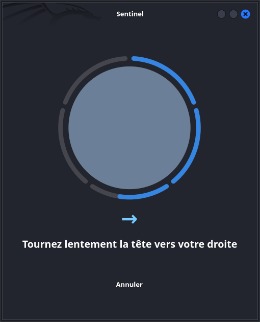
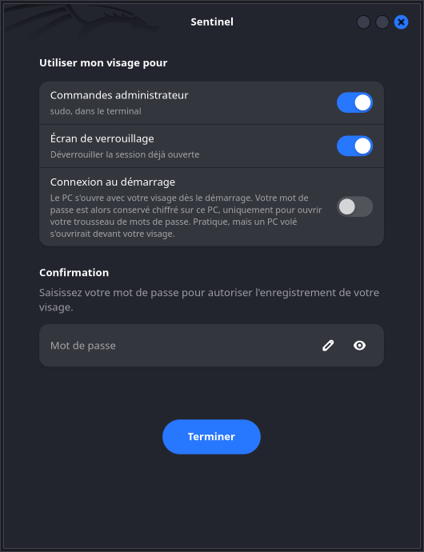

# Sentinel

**Authentification faciale pour Linux, 100 % locale, résistante à l'usurpation avec une webcam ordinaire.**

Déverrouillez `sudo`, l'écran de verrouillage et la session au démarrage en regardant
votre webcam, sans caméra infrarouge, sans cloud et sans jamais perdre l'accès par mot
de passe.


| Accueil | Enregistrement guidé | Choix et confirmation |
|---|---|---|
|  |  |  |

## Pourquoi Sentinel

Sous Linux, la reconnaissance faciale avec une webcam ordinaire se laisse tromper par une
**simple photo**. Les outils existants enregistrent parfois des **images du visage**, et
exécutent l'analyse d'images **avec les droits root**. Même Windows Hello a connu des
contournements : une caméra usurpée (CVE-2021-34466), un gabarit remplacé. Sentinel
part de ces faiblesses documentées ([conception](docs/CONCEPTION.md)).

| | Reconnaissance faciale classique sur webcam | **Sentinel** |
|---|---|---|
| Photo ou vidéo de l'utilisateur | souvent acceptée | refusée : vivant par IA, défi, relief 3D |
| Images du visage stockées | parfois | **jamais** |
| Données envoyées hors du PC | selon l'outil | **impossible** : service sans accès réseau |
| Analyse d'images en root dans PAM | oui | non : module C minimal + service isolé |
| Gabarit remplacé ou copié d'un autre compte | possible | refusé : chiffré et lié au compte |
| Clé de chiffrement | sur le disque | **scellée dans la puce TPM 2.0** |
| Visage absent, noir, webcam en panne | variable | mot de passe en 1 à 1,5 s |

## Fonctionnalités

- **Détection du vivant par IA** (MiniFASNet), décidée sur une moyenne de 10 images
  calibrée sur du matériel réel.
- **Défi adaptatif** : seulement si l'image est ambiguë, « tournez la tête vers votre
  gauche » ou « droite », tiré au sort, avec relief 3D et identité vérifiés pendant le geste.
- **Enregistrement guidé en 5 poses** (face, gauche, droite, haut, bas) qui mesure le
  relief du visage : une photo ne peut pas être enregistrée.
- **Calibration automatique** pour chaque personne et chaque webcam, bornée par un
  plancher de sécurité.
- **Écran de connexion GNOME** : le champ du mot de passe est masqué pendant la
  vérification, et un **bouton clé** permet de passer au mot de passe. Le trousseau
  s'ouvre lors d'une connexion par le visage (option).
- **Plusieurs comptes** : chacun son visage. Plusieurs webcams : la bonne est retrouvée,
  et une caméra infrarouge n'est prise qu'en dernier recours.
- **Assistant graphique** : aucune commande à taper, et un seul mot de passe, le vôtre,
  pour confirmer vos choix.
- **Journal des tentatives refusées**, avec des mesures, jamais d'image.

## Installation

```bash
# 1. Télécharger le paquet et SHA256SUMS : https://github.com/Tiburce-kay/sentinel/releases/latest (section « Assets »)
sha256sum -c SHA256SUMS                    # 2. vérifier le fichier (facultatif)
sudo apt install ./sentinel_*_amd64.deb    # 3. installer
```

Ouvrez ensuite **Sentinel** depuis le menu des applications : enregistrement du visage
en 30 secondes, choix des usages, confirmation.

**Désinstaller :** `sudo apt remove sentinel` (visages conservés) ou `sudo apt purge
sentinel` (tout effacé), puis redémarrer. `sudo` et l'écran de connexion reviennent
exactement à leur état d'origine ([détails](docs/INSTALLATION.md#8-désinstaller)).

**→ Guide complet, pas à pas : [docs/INSTALLATION.md](docs/INSTALLATION.md)**
(utilisation, mise à jour, désinstallation, résolution des problèmes, désactivation
d'urgence).

### Compatibilité

| Système | `sudo` | Écran de verrouillage et connexion | Champ masqué et bouton clé |
|---|---|---|---|
| Ubuntu 24.04+, Debian 13+, Kali (GNOME 45 à 51) | ✅ | ✅ | ✅ |
| Mêmes distributions avec un autre bureau (KDE, Xfce, Cinnamon) | ✅ | — (options grisées) | — |
| Ubuntu 22.04, Debian 12 et plus anciennes, processeurs ARM | installation refusée par `apt` | | |

- Il faut un PC 64 bits, une webcam et systemd. La puce TPM 2.0 est facultative, mais
  recommandée.
- Le paquet embarque son propre Python et ses bibliothèques d'IA : il continue de
  fonctionner après les mises à jour de la distribution.
- **GNOME 52 et suivants** : la reconnaissance faciale continuera de fonctionner. Le
  bouton clé et le champ masqué demandent une mise à jour de Sentinel, après essai sur
  chaque nouvelle version (procédure : [docs/MAINTENANCE.md](docs/MAINTENANCE.md#2-prendre-en-charge-une-nouvelle-version-de-gnome-52-et-suivantes)).

## Sécurité et vie privée

```
   sudo · écran de verrouillage · connexion GDM
                    │ PAM (« sufficient » : le mot de passe reste toujours possible)
                    ▼
        pam_sentinel.so  — module C minimal, aucune analyse d'image
                    │ socket Unix local, identité de l'appelant vérifiée (SO_PEERCRED, logind)
                    ▼
        sentineld — service isolé par systemd : sans réseau, sans privilèges,
        │            seule la caméra est accessible
        ├─ webcam USB vérifiée (caméras virtuelles refusées, identité épinglée)
        ├─ YuNet → SFace → MiniFASNet, modèles vérifiés par SHA-256
        └─ gabarits AES-256-GCM liés au compte, dossier réservé à root,
           clé scellée dans la TPM 2.0 (systemd-creds)
```

Les limites assumées sont décrites ouvertement : attaquant déjà root, masque 3D
réaliste, jumeau. Sentinel est un facteur de **confort** sûr, pas un remplaçant du mot
de passe pour les comptes les plus sensibles. Modèle de menaces complet :
[docs/CONCEPTION.md](docs/CONCEPTION.md). Signaler une faille : [SECURITY.md](SECURITY.md).

## Résultats

Mesures sur un ThinkPad T570, avec une webcam 640×480 sans infrarouge
([rapport technique](docs/RAPPORT.md), [données](docs/CALIBRATION.md)) :

| Mesure | Résultat |
|---|---|
| Utilisateur authentifié | 9 essais sur 9, en **1,2 à 1,4 s** |
| Autre personne | refusée (similarité ≤ 0,32, contre ≥ 0,69 pour l'utilisateur) |
| Photo et vidéo sur téléphone | **aucune fenêtre acceptée** (324 images de photo) |
| Calcul | ~150 ms par image sur un i5-6300U (2016) |

Ces chiffres portent sur une personne et une webcam. Une **campagne à plusieurs
personnes** est prête, avec un outil intégré (`sentinel campagne`), un protocole
ISO/IEC 30107-3 et un formulaire de consentement : [docs/CAMPAGNE.md](docs/CAMPAGNE.md).

## Documentation

| Document | Contenu |
|---|---|
| [INSTALLATION.md](docs/INSTALLATION.md) | guide de l'utilisateur : installation, usage, mise à jour, dépannage |
| [RAPPORT.md](docs/RAPPORT.md) | rapport technique : méthode, évaluation, limites, références |
| [CONCEPTION.md](docs/CONCEPTION.md) | objectifs, état de l'art, architecture, modèle de menaces, feuille de route |
| [CALIBRATION.md](docs/CALIBRATION.md) | mesures sur matériel réel et choix des seuils |
| [CAMPAGNE.md](docs/CAMPAGNE.md) · [CONSENTEMENT.md](docs/CONSENTEMENT.md) | protocole de tests à plusieurs personnes et formulaire |
| [MAINTENANCE.md](docs/MAINTENANCE.md) | publication, tests des paquets, nouvelles versions de GNOME |
| [CONTRIBUTING.md](CONTRIBUTING.md) | organisation du code, environnement de développement, règles |
| [CHANGELOG.md](CHANGELOG.md) | historique des versions |
| [THIRD_PARTY_NOTICES.md](THIRD_PARTY_NOTICES.md) | modèles et bibliothèques utilisés, licences |

## Feuille de route

- [x] Moteur, enrôlement 5 poses, calibration, défi adaptatif
- [x] `sudo`, écran de verrouillage, connexion au démarrage, trousseau GNOME
- [x] Clé scellée dans la TPM 2.0
- [x] Paquet `.deb` unique, testé automatiquement sur trois distributions
- [ ] Campagne de tests à plusieurs personnes et webcams (outillage prêt)
- [ ] Second défi par reflet de couleurs de l'écran
- [ ] Mise à jour adaptative des gabarits
- [ ] Paquets pour Fedora et Arch ; écrans de connexion KDE (SDDM) et LightDM

## Citer ce travail

Voir [CITATION.cff](CITATION.cff) : GitHub propose le format de citation (*Cite this
repository*).

## Licence

Copyright © 2026 Tiburce-kay. Sentinel est distribué sous la licence
**[PolyForm Noncommercial 1.0.0](LICENSE)**.

| Usage | Autorisé gratuitement |
|---|---|
| Personnel : sur son PC, études, loisirs, recherche, essais | ✅ |
| Établissements d'enseignement, organismes de recherche publics, associations, administrations | ✅ |
| Modifier le code et partager ses modifications, sans but commercial et en conservant la licence et la mention de l'auteur | ✅ |
| **Usage commercial** : entreprise (y compris en interne), produit ou service vendu, intégration dans une offre payante | ❌ **licence commerciale à obtenir auprès de l'auteur** |

Pour une licence commerciale, ouvrez un ticket intitulé « Licence commerciale » sur ce
dépôt, ou contactez l'auteur via son [profil GitHub](https://github.com/Tiburce-kay).

Ce tableau est un résumé : seul le texte de la licence ([LICENSE](LICENSE)) fait foi.
Les modèles et bibliothèques inclus gardent leurs licences propres (MIT, Apache-2.0,
BSD, PSF) : voir [THIRD_PARTY_NOTICES.md](THIRD_PARTY_NOTICES.md).
