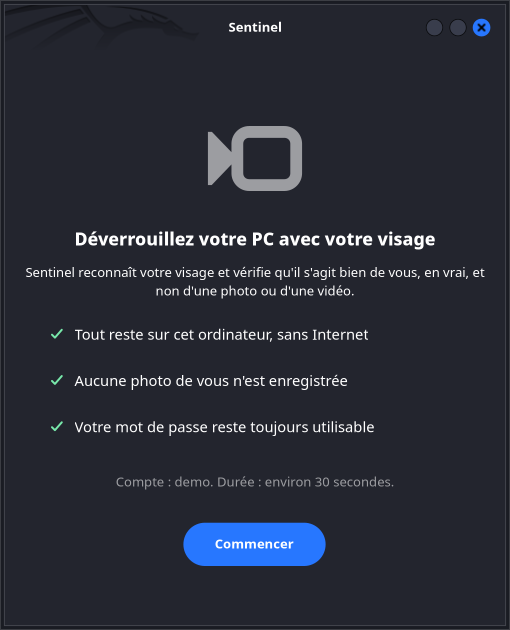
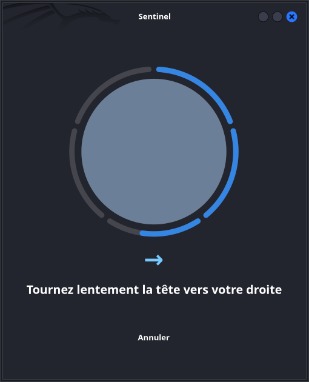
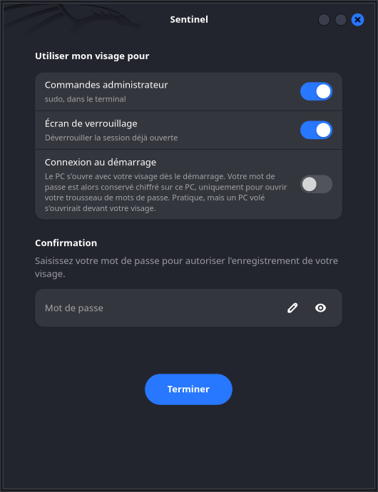
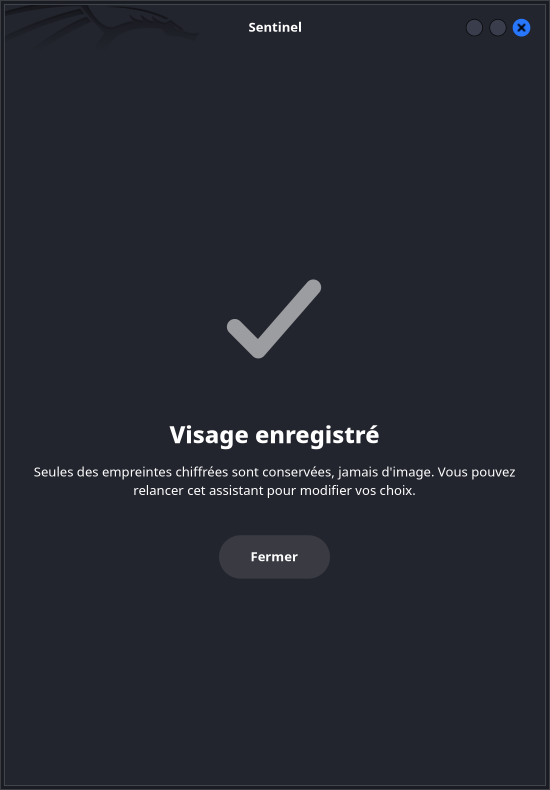

# Guide d'installation et d'utilisation

Ce guide s'adresse à toute personne qui veut utiliser Sentinel, sans connaissance
technique particulière. Comptez **5 minutes**, dont 30 secondes d'enregistrement du
visage.

## 1. Vérifier que votre PC est compatible

| Il faut | Comment vérifier |
|---|---|
| Ubuntu 24.04 ou plus récent, Debian 13 ou plus récent, ou Kali | Paramètres → À propos, ou `cat /etc/os-release` |
| Bureau GNOME 45 ou plus récent | Paramètres → À propos, ou `gnome-shell --version` |
| PC 64 bits (Intel ou AMD) | `uname -m` affiche `x86_64` |
| Une webcam (intégrée ou USB) | — |
| Facultatif : puce TPM 2.0, pour une protection maximale de la clé | `cat /sys/class/tpm/tpm0/tpm_version_major` affiche `2` |

Si votre système est trop ancien, l'installation est simplement refusée : rien n'est
modifié. Avec un autre bureau que GNOME (KDE, Xfce, Cinnamon), seul `sudo` peut
utiliser le visage.

## 2. Télécharger le paquet

**Avec le navigateur :**

1. Ouvrez la **[page de la dernière version](https://github.com/Tiburce-kay/sentinel/releases/latest)**.
2. Descendez tout en bas de la page, jusqu'à la section **Assets**.
3. Cliquez sur **`sentinel_<version>-1_amd64.deb`**, puis sur **`SHA256SUMS`**. Les deux
   fichiers arrivent dans votre dossier `Téléchargements`.

Sur la page d'accueil du projet, la même page s'ouvre par le lien **Releases**, dans la
colonne de droite.

**Ou dans un terminal**, ce qui télécharge toujours la dernière version :

```bash
cd ~/Téléchargements
wget https://github.com/Tiburce-kay/sentinel/releases/latest/download/SHA256SUMS
wget "https://github.com/Tiburce-kay/sentinel/releases/latest/download/$(cut -d' ' -f3 SHA256SUMS)"
```

**Vérifiez ensuite que le fichier n'a pas été altéré** (facultatif, mais recommandé) :

```bash
cd ~/Téléchargements
sha256sum -c SHA256SUMS
```
La réponse attendue est `sentinel_<version>-1_amd64.deb: Réussi` (ou `: OK` sur un système en anglais).

## 3. Installer

```bash
cd ~/Téléchargements
sudo apt install ./sentinel_*_amd64.deb
```

Le `./` est important : il indique à `apt` d'installer ce fichier plutôt que de le
chercher sur Internet. `apt` installe aussi les quelques composants nécessaires.

Deux messages peuvent apparaître, tous deux sans conséquence :
- « *Credential secret file … is not located on encrypted media* » : systemd signale
  que votre disque n'est pas chiffré. La clé de Sentinel reste protégée, par la puce TPM
  si votre PC en a une ;
- « *Le téléchargement est effectué en dehors du bac à sable…* » : `apt` indique
  seulement que le fichier se trouve dans votre dossier personnel.

À la fin, un message indique comment la clé de chiffrement est protégée :

| Message | Signification |
|---|---|
| `clé protégée : puce TPM 2.0 + secret du système` | protection maximale : la clé ne peut pas être lue depuis un autre PC |
| `clé protégée : secret du système` | pas de TPM 2.0 utilisable ; la clé reste chiffrée et réservée à root |

**Rien ne change encore** : Sentinel est branché sur `sudo` et l'écran de connexion,
mais il reste inactif pour chaque compte tant que la personne n'a pas enregistré son
visage et choisi ses usages. D'ici là, le mot de passe est demandé exactement comme avant.

## 4. Enregistrer votre visage

Ouvrez **Sentinel** depuis le menu des applications, puis cliquez sur **Commencer**.

| Étape | Ce que vous faites |
|---|---|
|  | **Accueil** : cliquez sur *Commencer*. |
|  | **Enregistrement** : l'écran devient blanc pour bien éclairer votre visage. Regardez la caméra, puis tournez **doucement** la tête dans la direction demandée : face, gauche, droite, haut, bas. Le cercle se remplit. |
|  | **Choix** : choisissez où utiliser votre visage, saisissez votre mot de passe, puis cliquez sur *Terminer*. Ce mot de passe prouve que c'est bien vous : personne ne peut enregistrer son visage sur votre compte. |
|  | **Terminé**. |

**Conseils pour l'enregistrement :** soyez de face, à 40-60 cm de l'écran, sans
lumière forte derrière vous. Gardez vos lunettes si vous les portez d'habitude.

### Les trois usages

| Usage | Ce que ça fait | Par défaut |
|---|---|---|
| Commandes administrateur | `sudo` dans un terminal | activé |
| Écran de verrouillage | déverrouiller la session déjà ouverte (Super+L, mise en veille) | activé |
| Connexion au démarrage | ouvrir la session dès le démarrage, trousseau de mots de passe compris | désactivé |

**À propos de la connexion au démarrage :** pour ouvrir votre trousseau de mots de passe
(Wi-Fi, navigateur…), Sentinel conserve votre mot de passe **chiffré** sur le PC. C'est
pratique, mais un PC volé s'ouvrirait devant votre visage. Laissez cette option
désactivée sur un PC portable qui voyage.

## 5. Utiliser Sentinel au quotidien

- **`sudo`** : tapez votre commande et regardez la caméra. La ligne
  `Sentinel : regardez la caméra…` s'affiche, puis `visage reconnu` en 1 à 2 secondes.
- **Écran de verrouillage et de connexion** : choisissez votre compte et regardez la
  caméra. Le champ du mot de passe est masqué pendant la vérification.
- **Le bouton clé « Utiliser le mot de passe »** arrête la vérification et affiche
  aussitôt le champ du mot de passe.
- **Un défi peut apparaître**, par exemple `Tournez la tête vers votre gauche`, quand
  l'image est difficile à juger. Tournez doucement la tête, puis revenez de face.

### Le mot de passe reste toujours possible

Sentinel ne bloque jamais l'accès. Le mot de passe est demandé comme d'habitude, en
1 à 1,5 seconde, dans tous ces cas : pièce trop sombre, personne devant la caméra,
webcam absente ou en panne, visage non reconnu, service arrêté.

Juste après le démarrage, le premier déverrouillage se fait par mot de passe, sauf si
vous avez activé la connexion au démarrage. Après **5 échecs** (photo présentée, autre
personne…), le visage est refusé jusqu'à ce que vous saisissiez votre mot de passe.

## 6. Modifier ses réglages, remplacer ou supprimer son visage

Ouvrez **Sentinel** depuis le menu :

- **Modifier mes réglages** : changer les usages sans refaire l'enregistrement ;
- **Remplacer mon visage** : refaire l'enregistrement, par exemple après un changement
  d'apparence important ou de webcam ;
- **Supprimer mon visage** : efface votre empreinte, et le mot de passe redevient le seul moyen.

Chaque personne du PC enregistre **son propre** visage depuis **sa propre** session :
le visage de l'une n'ouvre jamais le compte d'une autre.

## 7. Mettre à jour

Téléchargez le nouveau paquet, puis installez-le par-dessus l'ancien, **sans
désinstaller d'abord** :

```bash
sudo apt install ./sentinel_<nouvelle-version>-1_amd64.deb
```

Votre visage, vos réglages et votre clé sont conservés, et Sentinel reste activé.

## 8. Désinstaller

### Choisir ce que vous voulez faire

| Vous voulez… | Que faire |
|---|---|
| Ne plus utiliser **votre** visage, en gardant Sentinel pour les autres comptes | Ouvrez **Sentinel** → *Supprimer mon visage*, ou *Modifier mes réglages* pour couper un seul usage. Pas besoin de désinstaller. |
| Retirer Sentinel **en gardant** les visages, pour le réinstaller plus tard | `sudo apt remove sentinel` |
| Retirer Sentinel **et tout effacer** : visages, mot de passe conservé, clé de chiffrement | `sudo apt purge sentinel` |

### Étapes

1. **Ouvrez un terminal et tapez la commande choisie**, par exemple :

   ```bash
   sudo apt purge sentinel
   ```
   Confirmez avec `O` (ou `Y` sur un système en anglais). Sentinel peut encore vous
   reconnaître pour cette dernière commande `sudo` : c'est normal.

2. **Redémarrez le PC**, ou au moins fermez puis rouvrez votre session. L'écran de
   connexion et l'écran de verrouillage retrouvent alors leur apparence d'origine,
   sans bouton clé.

3. **Vérifiez** que tout est revenu comme avant :

   ```bash
   sudo -k && sudo true
   ```
   Votre mot de passe doit être demandé, sans message « Sentinel ».

### Ce qui se passe pendant la désinstallation

1. La configuration de sécurité du système (PAM) de `sudo` et de l'écran de connexion
   est remise **dans son état d'origine**, à l'identique, **avant** la suppression du
   moindre fichier. À aucun moment `sudo` ou l'écran de connexion ne se retrouvent
   bloqués.
2. Le service Sentinel est arrêté, puis le programme, les modèles d'IA et l'extension
   sont supprimés.
3. Selon la commande :

| | `apt remove` | `apt purge` |
|---|---|---|
| Programme, service, extension, réglages de l'écran de connexion | supprimés | supprimés |
| Empreintes des visages, mot de passe conservé | **conservés** (chiffrés, réservés à root) | **effacés** |
| Clé de chiffrement (puce TPM ou fichier) | **conservée** | **effacée** |
| Fichiers de configuration de Sentinel | conservés | effacés |

Après un `apt remove`, réinstaller le paquet retrouve vos visages et vos réglages. Vous
pouvez aussi tout effacer plus tard avec `sudo apt purge sentinel`, même après un
`remove`.

**Facultatif :** GNOME garde le nom de l'extension dans votre liste d'extensions, ce qui
est sans effet une fois Sentinel retiré. Pour l'en retirer aussi :

```bash
gsettings set org.gnome.shell enabled-extensions "$(gsettings get org.gnome.shell enabled-extensions | sed "s/, 'sentinel@tiburce-kay.github.io'//")"
```

## 9. En cas de problème

| Symptôme | Que faire |
|---|---|
| « visage trop loin… », « image floue… », « tête trop inclinée… » | La caméra vous voit, mais l'image n'est pas exploitable : suivez le conseil affiché, puis réessayez. |
| « délai écoulé avant confirmation » ou « tête trop tournée » | Restez de face, immobile, une à deux secondes. |
| `sudo` demande toujours le mot de passe | Juste après le démarrage, c'est normal : saisissez-le une fois. Sinon, ouvrez Sentinel et vérifiez que *Commandes administrateur* est activé. |
| « trop sombre : utilisez votre mot de passe » | Allumez une lampe face à vous. La webcam ordinaire ne voit pas dans le noir. |
| « usurpation suspectée (photo, écran ou vidéo) » avec votre vrai visage | Évitez les forts contre-jours et regardez la caméra de face. Si cela se répète, refaites l'enregistrement dans votre éclairage habituel. |
| « caméra différente de celle de l'enrôlement » | Vous avez changé de webcam : *Remplacer mon visage*. |
| « trop d'échecs : mot de passe requis » | Saisissez votre mot de passe une fois : le visage est réactivé. |
| Le bouton clé n'apparaît pas | Fermez la session et rouvrez-la. Vérifiez que votre version de GNOME est prise en charge (section 1). |
| Le bouton *Commencer* est grisé | Le service ne répond pas : `systemctl status sentineld`. Si le message parle de visage illisible, utilisez *Remplacer mon visage*. |

Le journal de Sentinel contient des mesures, jamais d'image :

```bash
journalctl -u sentineld -n 30                # derniers essais
journalctl -u sentineld -p warning           # tentatives refusées et verrouillages seulement
```

### Désactiver Sentinel en urgence

Même si Sentinel ne bloque jamais le mot de passe, vous pouvez tout désactiver d'un
coup, depuis un terminal :

```bash
sudo /usr/sbin/sentinel-pam sync --sudo off --screen off
```

Ce choix vaut pour tous les comptes du PC et il est conservé lors des mises à jour.
Pour réactiver : `sudo /usr/sbin/sentinel-pam sync --sudo on --screen on`.

Si la session graphique est inaccessible : **Ctrl+Alt+F3**, connexion avec votre nom
d'utilisateur et votre mot de passe, la commande ci-dessus, puis **Ctrl+Alt+F1** (ou
**F2**) pour revenir à l'écran de connexion.

## 10. Vie privée

- **Aucune image n'est enregistrée**, ni à l'enregistrement, ni à l'utilisation.
  Sentinel conserve une empreinte numérique (128 nombres) par pose, chiffrée.
- **Rien ne sort du PC** : le service n'a techniquement pas accès au réseau, et ce n'est
  pas seulement une promesse (`PrivateNetwork=yes`, `IPAddressDeny=any`).
- La caméra ne s'allume que pendant une vérification, et son voyant le montre.
